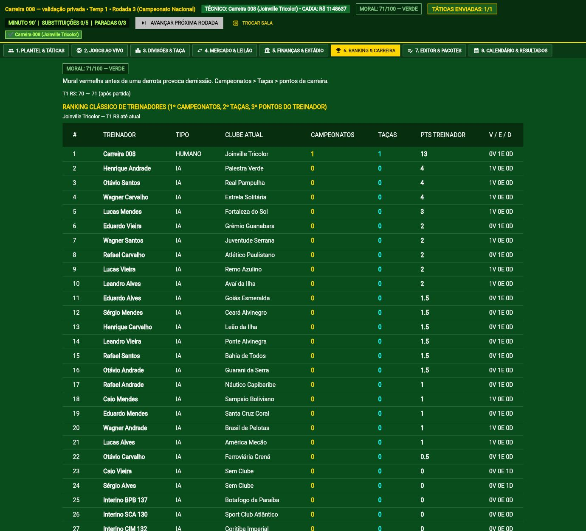

# Auditoria de carreira 008

30/10/2026 — D:\elifoot_98 — DEV privado. STATUS: **PASS**.

Carreira de humanos e IA implementada e executada: moral, demissão, desemprego, convites, mudança de clube, pontos fracionários exatos e títulos. Regressão: **94 testes .NET e 10 Flutter aprovados**. Foram simuladas **50 temporadas reais, 17550 partidas e 1628700 minutos**, com 128 clubes e oito humanos. O navegador executou uma partida completa e recuperou a mesma carreira após reinício do processo da API.

[Moral](COACH_MORALE_RULES_008.md) · [Convites e IA](COACH_INVITATION_AI_008.md) · [Ranking](COACH_RANKING_008.md) · [Testes e reprodução](COACH_CAREER_TESTS_008.md)

## Antes das alterações

O registro [BASELINE_RULES.md](audit-008/BASELINE_RULES.md) foi criado antes da implementação. Não há repositório Git neste diretório. Foram preservados 70 arquivos e seus SHA256 no [manifesto inicial](audit-008/baseline-manifest.json), com cópias em audit-008/baseline.

| Área | Regra encontrada | Regra final |
| --- | --- | --- |
| Moral | Não existia. | 0–100, três faixas configuráveis e histórico. |
| Demissão | Humano ao cair para Distrital; IA rebaixada rotacionava. | Moral vermelha no início + derrota; Distrital independente da moral; IA rebaixada abre vaga. |
| Pontos | Inteiros por mando: vitória 2/3, empate 1/2, inclusive Taça. | decimal por divisão e fase; crédito ao treinador registrado no início. |
| Ranking | Campeonatos > Taças > pontos; depois vitórias e humano. | Mesma prioridade principal; desempate final exclusivamente por CoachId. |
| Títulos | Só Primeira; Taça podia usar campeão da liga como fallback. | Quatro divisões; Taça somente por final válida; conquista com dono e chave única. |
| Convites | Desempregados, até três, sem moral, recusa ou projeto. | Empregados/desempregados verdes, projeto e experiência; recusa busca próximo; interino mantém jogos. |
| Vínculos | Aceite podia deixar humano e IA simultâneos e histórico aberto. | Exclusividade e fechamento do emprego anterior sob lock da sala. |
| Interface | Ranking e ASSUMIR CLUBE. | Moral e histórico visíveis; comparação da proposta; ACEITAR/RECUSAR. |

## Resultado medido

| Métrica | Execução final |
| --- | --- |
| Seed / temporadas / clubes / humanos | 199801 / 50 / 128 / 8 |
| Partidas / minutos | 17550 / 1628700 |
| Convites humanos aceitos / recusados | 220 / 49 |
| Convites IA aceitos / recusados | 1402 / 27323 |
| Demissões por moral vermelha + derrota | 616 |
| Humanos rebaixados da Quarta para Distrital | 16 |
| Demissões IA por rebaixamento | 326 |
| Total de registros de demissão | 958 |
| Títulos | 250: 200 campeonatos e 50 Taças |
| Replay | Uma temporada executada duas vezes com assinatura idêntica; as duas execuções finais de 50 temporadas também coincidiram. |

Fonte integral: [COACH_CAREER_50_SEASONS_008.json](audit-008/career-final-evidence/COACH_CAREER_50_SEASONS_008.json). As recusas IA incluem candidatos avaliados e rejeitados por projeto/incompatibilidade; não equivalem a partidas ou pessoas únicas. A política dos humanos automatizados aceita deterministicamente 75% das oportunidades consideradas, usando a mesma rotina de resposta da aplicação.

Assinatura dos resultados e estado final de carreira: **474E4A3579EFDC4D0441464EA37ABE4C07173172636110AB8DE6160A544355AE**. Não inclui timestamps/GUIDs de auditoria sem significado para o jogo.

## Navegador real

Sala privada em http://127.0.0.1:8088/, API em http://127.0.0.1:5088/. Banco isolado e IDs em [browser-used-fixture.json](audit-008/browser-used-fixture.json); processos em [dev-session.json](audit-008/dev-session.json). A aba original do usuário não foi utilizada para alterar a partida existente.

1. Entrou como Carreira 008 desempregado, com duas ofertas reais no banco de QA.
2. Clicou RECUSAR para Ferroviária e ACEITAR para Joinville Tricolor. Recarregou e preservou o clube.
3. Conferiu verde e, temporariamente, amarelo/vermelho por configuração das faixas no servidor. As regras padrão 60/30 foram restauradas antes de jogar.
4. Enviou a tática, viu 1/1, disputou o primeiro tempo, clicou PRONTO para o segundo e concluiu os 90 minutos: **Ferroviária 0–0 Joinville**.
5. Os pontos passaram de **12,5 para 13** e a moral de **70 para 71**, com registro T1 R3.
6. O processo da API foi encerrado e reiniciado contra o mesmo SQLite. Recarregou, restaurou sessão e confirmou clube, pontos e histórico. A API foi novamente atualizada para o build final e a página foi conferida.

Os valores iniciais de um campeonato, uma Taça e 12,5 pontos foram preparados na fixture para verificar preservação. Não são conquistas obtidas nessa partida no navegador. A sobrevivência de ofertas ainda pendentes foi verificada separadamente por integração SQLite após limpar o cache e recarregar; no reinício visual as ofertas já estavam respondidas.

Capturas: [ofertas](audit-008/web-invitations.jpg), [recusa](audit-008/web-rejected.jpg), [aceite](audit-008/web-accepted.jpg), [reconexão](audit-008/web-reconnected.jpg), [amarelo configurado](audit-008/web-yellow-configured.jpg), [vermelho configurado](audit-008/web-red-configured.jpg), [partida no intervalo](audit-008/web-live-match.jpg), [resultado aos 90](audit-008/web-match-finished.jpg), [reinício](audit-008/web-server-restarted.jpg). Em amarelo/vermelho, moral 70 usa limiares temporários; com os padrões, 70 é verde. [Validação estruturada](audit-008/web-validation.json).

## Correções adicionais sustentadas por reprodução

- A moral variava 79/80 ao inverter a ordem dos mesmos jogos: a tabela era atualizada parcialmente durante a avaliação. A liquidação passou a atualizar toda a tabela primeiro e depois as carreiras. [Falha original](audit-008/morale-order-reproduction.log), teste determinístico aprovado.
- Um agente comprava titular de outro humano depois da seleção deste, deixando dez titulares no harness. [Reprodução](audit-008/lineup-reproduction.log). O harness agora revalida todos após todas as ações de mercado.
- A mesma janela existia no orquestrador real entre envio e início: [reprodução](audit-008/ready-lineup-reproduction.log). Antes de iniciar, valida todas as escalações enviadas; se um titular saiu, retira o pronto e solicita novo envio. Modo automático recompõe primeiro. Não houve mudança na regra de transferência, tática ou substituição.
- IA recém-demitida e ainda verde podia reassumir imediatamente como interina. O interino também respeita duas rodadas após demissão.
- Byes terminados sem minuto disputado não geram pontos, estatística ou título; final sem vencedor não inventa campeão.

Logs de tentativas anteriores com falhas foram preservados. O resultado final é o da [regressão completa](audit-008/final-tests.log), seguido pelos testes de fechamento. O último ajuste de produção somente tornou explícita a razão EXPERIENCE_FOR_DIVISION na recusa; a execução de 50 temporadas repetida manteve exatamente a assinatura.

## Migração e persistência

O mundo já é persistido como snapshot JSON no repositório EF. A versão CareerRulesVersion=8 é inicializada no mundo novo e aplicada após desserializar mundo legado em cada caminho de leitura. Não foi necessário alterar tabelas SQL. CoachPoints passou de int para decimal; os inteiros legados são representados exatamente.

Preservam-se IDs, empregos existentes, títulos agregados, estatísticas, pontos e personalidade. Moral ausente começa em 70; histórico de moral ausente permanece vazio. Para vínculo sem histórico, cria-se registro de continuidade a partir da temporada/rodada da migração, sem inventar a data original. Jogos antigos já terminados são marcados como aplicados para evitar crédito duplicado. Corrige-se vínculo simultâneo humano/IA e humano em Distrital. Convite antigo viável recebe chave de vaga e validade de três rodadas; clube humano ou Distrital invalida a oferta. O aceite revalida a elegibilidade atual.

Teste de legado remove os campos 008 de um JSON real, carrega-o, migra duas vezes e aceita convite antigo: **42 pontos, três campeonatos e duas Taças preservados**, sem reprocessar partida passada. Testes SQLite verificam pontos, ranking, moral e ofertas; a suíte anterior também executou persistência PostgreSQL 18.

Limite explícito: os totais antigos não permitem reconstruir exatamente a nova pontuação por divisão, donos de títulos antigos ou moral anterior. **Não há recálculo retroativo**; o saldo anterior é mantido e as regras novas passam a valer para jogos novos. O registro detalhado de conquistas começa na 008; agregados legados continuam no ranking. Faça backup do banco/snapshot completo antes de abrir saves importantes. Pacote do editor de clubes/jogadores cria conteúdo de mundo; não substitui backup completo de carreira.

## Preservação e arquivos

Não houve investigação Android nem publicação. Motor, defesa, mercado, economia e táticas foram preservados; a evolução de força e o ranking de jogadores não foram alterados. As mudanças 007 no ledger e métricas foram mantidas. [Prova de preservação](audit-008/preservation.json), [diff dos arquivos existentes](audit-008/source-diff.patch) e [manifesto final](audit-008/evidence-manifest.json).

| Arquivo existente alterado | Finalidade |
| --- | --- |
| tests/Elifoot.Simulation.Tests/MultiSeasonAndBenchmarkTests.cs | Atribuição ao técnico inicial e revalidação das escalações após o mercado de todos os agentes. |
| src/Elifoot.Infrastructure/EfWorldRepository.cs | Migração após desserializar snapshots legados. |
| src/Elifoot.Domain/WorldSeedFactory.cs | Inicializa a versão 008 no mundo novo. |
| src/Elifoot.Domain/Entities.cs | Estado persistente de carreira, moral, títulos, vagas e pontos decimal. |
| src/Elifoot.Domain/CompetitionAndSeasonEngine.cs | Liquidação idempotente, tabela completa antes da moral, títulos das quatro divisões e ranking. |
| src/Elifoot.Contracts/Dtos.cs | Pontos decimal e dados de moral/projeto nos contratos. |
| client/elifoot_flutter/lib/main.dart | Moral, histórico, propostas e botões ACEITAR/RECUSAR. |
| client/elifoot_flutter/lib/api_client.dart | Cliente HTTP da recusa. |
| client/elifoot_flutter/test/widget_test.dart | As três faixas no fluxo existente de interface. |
| src/Elifoot.Api/Program.cs | Recusa HTTP e configuração de faixas; consulta de carreira. |
| src/Elifoot.Application/ClubAndMarketApplicationService.cs | Responder e consultar carreira sob o lock da sala; configurar moral. |
| src/Elifoot.Application/MultiplayerRoundOrchestrator.cs | Snapshot no início, exclusividade, estado pronto e validação final da escalação. |

Novos arquivos de código, testes e geração:

- src/Elifoot.Domain/CoachCareerEngine.cs
- tests/Elifoot.Domain.Tests/CoachCareer008Tests.cs
- tests/Elifoot.Application.Tests/CoachCareer008ReadinessTests.cs
- tests/Elifoot.Integration.Tests/CoachCareer008IntegrationTests.cs
- tests/Elifoot.Simulation.Tests/CoachCareer008SimulationTests.cs
- client/elifoot_flutter/test/career_api_test.dart
- scripts/report-coach-career-008.mjs

Além desses arquivos, foram criados os cinco relatórios COACH_*_008.md, baseline, logs, TRX, JSON e capturas em docs/audit-008. Binários e SQLite de QA ficam em artifacts/coach-career-008.

## Limites restantes

- Migração preserva agregados históricos; não inventa o detalhamento que faltava.
- A atratividade usa uma heurística determinística e explicável; a tarefa não demonstra que os pesos sejam o ótimo de balanceamento para todo save.
- A primeira escolha de clube continua livre entre os clubes elegíveis, conforme o fluxo existente; um humano já empregado/demitido deve usar convites nas mudanças seguintes.
- Interinos novos podem elevar a população total de treinadores; a invariável é 128 clubes com exatamente um titular cada. O ranking final tem 170 entradas elegíveis, sem exigir 128 treinadores permanentes.
- Esta tarefa não reabre o bloqueio Android nem declara runtime Android aprovado.

## Relatório final

| Campo | Resultado |
| --- | --- |
| STATUS | PASS |
| MORALE | PASS |
| RED_MORALE_DISMISSAL | PASS |
| DISTRICT_DISMISSAL | PASS |
| UNEMPLOYED_RECOVERY | PASS |
| RANKING | PASS |
| LEAGUE_TITLES_PRIORITY | PASS |
| CUP_TITLES_PRIORITY | PASS |
| CAREER_POINTS | PASS |
| DIVISION_POINTS | PASS |
| CUP_PHASE_POINTS | PASS |
| INVITATIONS | PASS |
| RANK_EVALUATION | PASS |
| MORALE_REQUIREMENT | PASS |
| CLUB_ATTRACTIVENESS | PASS |
| HUMAN_ACCEPT_REJECT | PASS |
| AI_ACCEPT_REJECT | PASS |
| NEXT_CANDIDATE_AFTER_REFUSAL | PASS |
| AI_MANAGER_TRANSFERS | PASS |
| CAREER_PERSISTENCE | PASS |
| MULTIPLAYER_REGRESSION | PASS |
| DATABASE_MIGRATION | PASS — JSON versionado; sem DDL |
| WEB_INTERFACE | PASS — navegador real, partida aos 90 e reinício real |
| TESTS | 94 .NET + 10 Flutter; analyze/build aprovados |
| FILES_CHANGED | 12 arquivos existentes; 7 arquivos novos de código/testes/relatório; 5 documentos finais e evidências |
| KNOWN_ISSUES | Limites de migração histórica e heurística de projeto documentados; sem bloqueio aberto da tarefa 008. |
