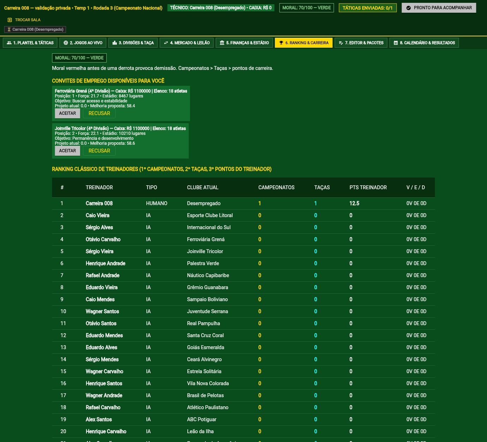
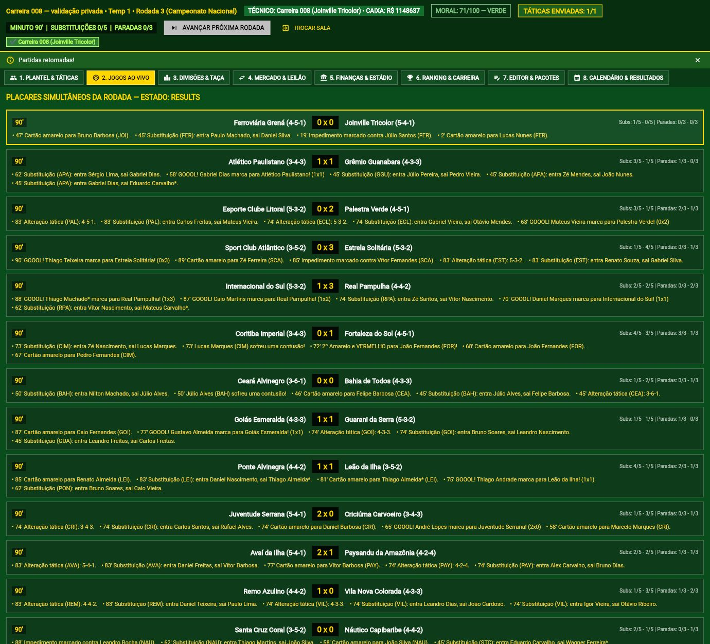
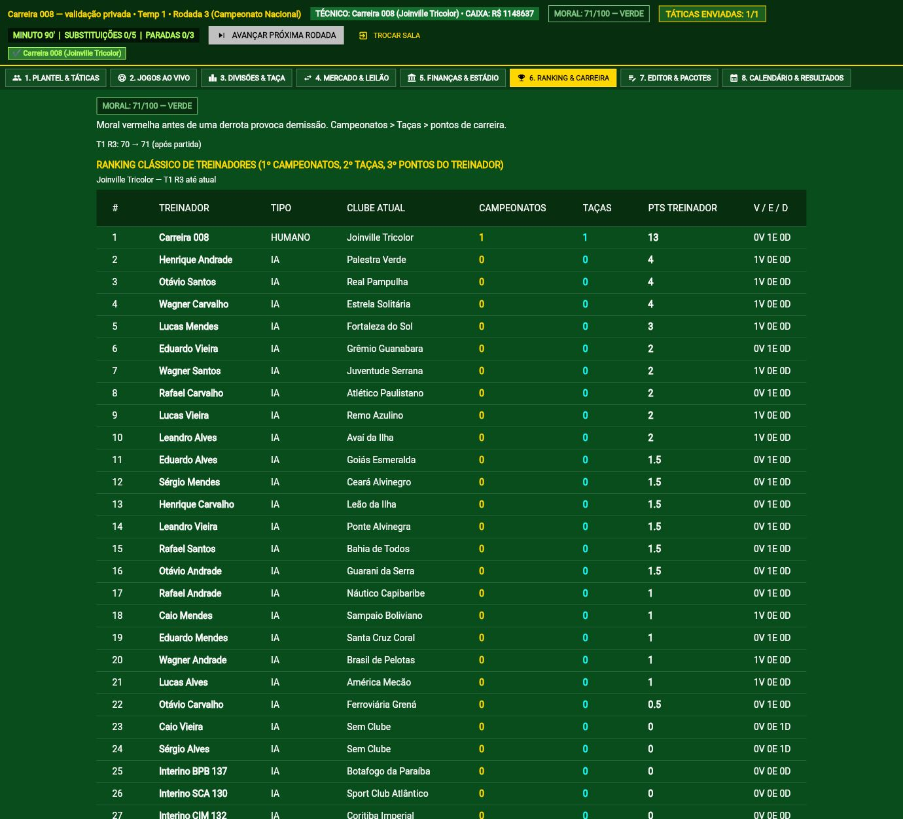

# Testes e reprodução 008

30/10/2026. STATUS: PASS. Logs brutos e tentativas com falhas foram preservados.

## Resultado final

| Suíte | Aprovados | Falhas |
| --- | --- | --- |
| Domínio | 66 | 0 |
| Aplicação | 5 | 0 |
| Integração | 18 | 0 |
| Simulação | 5 | 0 |
| Total .NET | 94 | 0 |
| Flutter | 10 | 0 |

Compilação Release sem erros/avisos; Flutter analyze sem problemas; build web Release aprovado. .NET SDK 10.0.302; Flutter 3.38.5, Dart 3.10.4; Node v24.20.0. Não foram atualizadas dependências para esta tarefa.

Baseline007 tinha 52 casos .NET e oito Flutter. A 008 adiciona 32 de domínio, um de aplicação, sete de integração e dois de simulação = 42, total 94. Flutter acrescenta dois testes API, e estende o teste visual existente às três faixas = dez. Número de cenários não equivale ao número de métodos: theories expandem parâmetros.

[Log final .NET](audit-008/final-tests.log) e [TRX completos](audit-008/final-tests/). A matriz existente, regressão longa de 100 temporadas e cenários humanos/stress/mercado também foram executados nessa suíte; seus artefatos foram redirecionados a audit-008/final-regression para preservar os relatórios 005/006/007. Os testes antigos de SignalR usam clientes independentes 2/4/6/8, pausa global, substituições e desconexão/reconexão. PostgreSQL 18 também foi exercitado pelo teste existente de persistência.

Após a regressão completa, o último ajuste de produção corrigiu apenas o texto da razão de candidato sem experiência. Reexecutados os 32 casos de domínio e as 50 temporadas; a assinatura final coincidiu integralmente. As asserções de migração JSON legado, próximo humano após recusa e bloqueio durante partida foram fortalecidas; domínio32 e integração7 passaram novamente. Não se soma essas repetições aos 94 casos únicos.

- [Domínio32](audit-008/closure-domain-tests.log), [TRX](audit-008/closure-domain-tests/career32-final.trx).
- [Integração7](audit-008/closure-integration-tests.log), [TRX](audit-008/closure-integration-tests/career7-final.trx).
- [Carreira50 final](audit-008/closure-career50.log), [TRX](audit-008/closure-simulation-tests/career50-final.trx).
- [Flutter analyze](audit-008/flutter-analyze.log), [Flutter10](audit-008/flutter-tests.log), [web build](audit-008/web-build.log), [API final](audit-008/api-closure-build.log).

## Cobertura dos 34 itens exigidos

| Itens do pedido | Verificação | Teste/evidência |
| --- | --- | --- |
| 1–6 | Moral cai/sobe, verde→amarelo→vermelho, vermelho perde/vence | MoraleBandsAndPreMatchRedDismissal (6 casos) |
| 7 | Demissão idempotente | MoraleBandsAndPreMatchRedDismissal + replay |
| 8 | Desempregado mantém ranking | RankingIsLexicographicAndTiesAreStableAcrossReloadAndUnemployment |
| 9 | Recuperação gradual | UnemployedRecoveryIsGradualOncePerRoundAndNeverDeletesCareer |
| 10–12 | Só verde recebe/aceita | OnlyGreenHumanReceivesOpportunity (3) + PendingOfferCannotBeAcceptedAfterMoraleFallsBelowGreen (2) |
| 13–14 | Elite recusa; líder pequeno aceita estrutura superior | EliteLeaderRejectsLowerProjectButSmallLeaderCanAcceptGreatStructure |
| 15 | Próximo após recusa | SearchContinuesAfterAiRefusalAndPreservesPersonalityOnAcceptedMove + HTTP recusa oferece ao próximo humano |
| 16–17 | Humano aceita/recusa | HumanCanAcceptOrRejectThroughHttpAndReceivesUpdatedOwnership (2) + navegador |
| 18–19 | IA muda e preserva personalidade | SearchContinuesAfterAiRefusalAndPreservesPersonalityOnAcceptedMove |
| 20–21 | Distrital demite; promovido fica elegível | DistrictRelegationDismissesRegardlessOfMorale_AndPromotedClubIsEligible |
| 22–24 | Prioridade campeonatos/Taças/pontos | RankingIsLexicographicAndTiesAreStableAcrossReloadAndUnemployment |
| 25 | Valores de divisão | ExactDecimalDivisionPoints (4) |
| 26–27 | Fases e pênaltis | CupPhaseWinAndPenaltiesCreditOnce (6) + SixCupWinsEqual33AndTitleIsSeparate_NoByeTitle |
| 28 | Títulos não duplicam | EveryCompletedDivisionAwardsOneTitleToItsClosingMatchCoach + testes Taça |
| 29 | Pontos não duplicam | CreditBelongsToKickoffCoachEvenAfterClubChanges_AndReplayReloadIsIdempotent + 50 temporadas |
| 30 | Ranking após reinicialização | SqliteRestartPreservesRankingPendingOffersAndCareer_AndWritesPrivateBrowserFixture + reinício real da API |
| 31 | Multiplayer sincronizado | Suíte anterior API/SignalR, 2/4/6/8 clientes, pausa/substituições/reconexão |
| 32 | Aceite simultâneo | ConcurrentAcceptancesCannotDuplicateClubOrCoach_AndInFlightChangesAreRejected |
| 33 | Ofertas persistem | SqliteRestartPreservesRankingPendingOffersAndCareer_AndWritesPrivateBrowserFixture (cache limpo, disco) |
| 34 | Desempregado no contador | HostCanConfigureMoraleBandsWithValidationAndUnemployedCountsInReadyCounter |

Também há testes para bye sem minuto, final sem campeão inventado, título em todas as divisões, crédito ao treinador no início após troca, migração repetida sem histórico fictício, IA impedida de reassumir imediatamente, ordem de jogos sem efeito na moral e venda de titular já confirmado. Essas verificações exercitam limites reais além da lista do pedido.

## Execução de 50 temporadas

Seed199801, 128 clubes, oito humanos, calendário e MatchSimulationEngine reais, sem placares agregados artificiais. A cada rodada: convites/respostas, montagem de escalações, partidas minuto a minuto, finanças, carreira e mercado. Foram verificadas propriedade exclusiva em todos os clubes, humano fora da Distrital, moral0–100, reprocessamento sem novos pontos/títulos e cinco títulos por temporada.

17550 partidas, 1628700 minutos; 220/49 aceites/recusas humanos; 1402/27323 IA; 958 demissões; 250 títulos. O relatório contém cada convite, demissão, título, ranking e comparação de pontuação.

Assinatura50: 474E4A3579EFDC4D0441464EA37ABE4C07173172636110AB8DE6160A544355AE. Replay de uma temporada duas vezes: 420D97C8E153334B7664A2D0F997FC592A0181B90B776E7DF2DD68349D69F2BB. A segunda execução final das 50 temporadas também teve a mesma assinatura50. Timestamps de auditoria não compõem a assinatura. [JSON final](audit-008/career-final-evidence/COACH_CAREER_50_SEASONS_008.json).

## Validação visual e persistência real

O navegador fez login, entrou desempregado, recusou Ferroviária, aceitou Joinville, recarregou e verificou histórico/clube. Com as faixas padrão restauradas, enviou tática, confirmou segundo tempo e terminou 0–0 aos90. Pontos12,5→13 e moral70→71. Reiniciar o processo da API e recarregar preservou tudo. A versão compilada final foi carregada e novamente conferida. [AX final](audit-008/web-final-ax.txt), [resposta da API final](audit-008/web-final-api.json), [validação estruturada](audit-008/web-validation.json).

As capturas amarela/vermelha usaram limiares temporários via API do anfitrião, para testar a renderização sem forjar derrotas. Não demonstram uma série de derrotas na sessão visual; essa transição foi exercitada deterministicamente nos testes. Títulos iniciais foram semeados, não conquistados na sessão. A validação visual foi desktop; o teste Flutter existente também verificou o fluxo de largura390. Não se declara validação Android nesta tarefa.

## Comandos reproduzíveis (PowerShell)

Executados a partir de D:\elifoot_98. Use uma nova pasta de execução para não sobrescrever as evidências entregues:

~~~powershell
Set-Location D:\elifoot_98
$run008 = Join-Path (Get-Location) ('artifacts\coach-career-008\rerun-' + (Get-Date -Format yyyyMMdd-HHmmss))
New-Item -ItemType Directory -Path $run008 -Force | Out-Null
$env:ELIFOOT_AUDIT_OUTPUT = $run008
dotnet build Elifoot.slnx -c Release
dotnet test Elifoot.slnx -c Release --no-build --logger 'trx;LogFileName=rerun008.trx' --results-directory $run008
dotnet test tests/Elifoot.Domain.Tests -c Release --filter FullyQualifiedName~CoachCareer008Tests
dotnet test tests/Elifoot.Integration.Tests -c Release --filter FullyQualifiedName~CoachCareer008IntegrationTests
dotnet test tests/Elifoot.Simulation.Tests -c Release --filter FullyQualifiedName~CoachCareer008_FiftyRealSeasonsAndDeterministicReplay
Push-Location client\elifoot_flutter
flutter analyze
flutter test
flutter build web --release --dart-define=API_BASE_URL=http://127.0.0.1:5088 --output=..\..\artifacts\coach-career-008\web
Pop-Location
~~~

A suíte de integração cria fixture SQLite nova e atualiza browser-fixture.json; a fixture efetivamente usada na validação entregue foi congelada em browser-used-fixture.json. Não substitua esse arquivo histórico. O teste existente PostgreSQL requer o servidor DEV local configurado, como na execução aprovada.

Para abrir a mesma sessão entregue, a API5088 e o servidor web8088 ficaram em execução privada. Para reiniciar quando as portas estiverem livres, consulte dev-session.json e use o mesmo banco. Não encerre processos alheios se houver conflito:

~~~powershell
$session008 = Get-Content docs\audit-008\dev-session.json -Raw | ConvertFrom-Json
$env:ASPNETCORE_ENVIRONMENT = 'LocalDev'
$env:Elifoot__DatabaseProvider = 'Sqlite'
$env:Elifoot__AutoSeedDefaultWorld = 'false'
$env:ConnectionStrings__DefaultConnection = "Data Source=$($session008.Database)"
Start-Process dotnet -ArgumentList @('D:\elifoot_98\src\Elifoot.Api\bin\Release\net10.0\Elifoot.Api.dll','--urls','http://127.0.0.1:5088') -WorkingDirectory D:\elifoot_98\src\Elifoot.Api -WindowStyle Hidden
Start-Process node -ArgumentList @('D:\elifoot_98\scripts\serve-web.mjs','8088','D:\elifoot_98\artifacts\coach-career-008\web') -WorkingDirectory D:\elifoot_98 -WindowStyle Hidden
~~~

Abra http://127.0.0.1:8088/. Identidade de QA: Carreira 008 / qa008-web. A sala já está no resultado da rodada3; a carreira tem Joinville,13 pontos,71 moral. Para recriar o cenário de propostas iniciais, use a nova fixture produzida pelo teste SQLite, não edite a evidência já concluída.

Geração destes cinco documentos e verificação dos artefatos:

~~~powershell
node scripts/report-coach-career-008.mjs
~~~

O gerador confere os TRX, total94, Flutter10, assinaturas de50 temporadas e arquivos protegidos. Registra SHA256 do código alterado, novos testes e evidências. Logs api-live/web.stdout e metadados de processos ativos são mutáveis e excluídos do manifesto estático. O SQLite vivo também não é tratado como arquivo estático; os snapshots de validação são as evidências estáveis.
