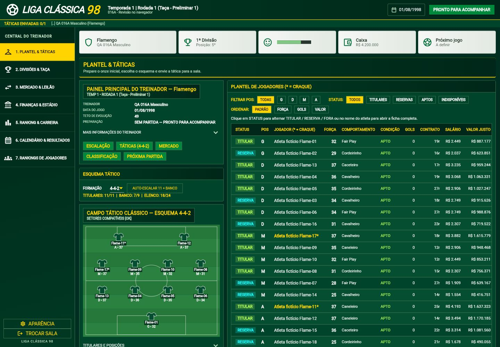
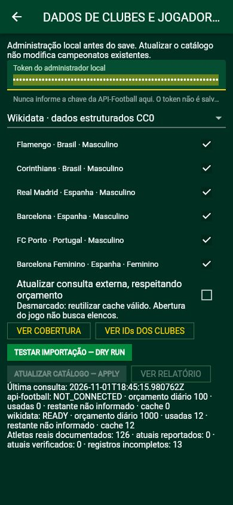

# Entrega local — 016A

**PARTIAL**: importador seguro implementado e validado em DEV; cobertura real atual ainda incompleta, conforme a decisão de continuar sem chave.

O piloto verificou os seis clubes e importou 113 referências históricas válidas de atletas. Nenhuma foi apresentada como vínculo atual. Não houve merge, push ou produção. Os worktrees anteriores foram preservados. Os testes passaram: 680 .NET, 173 Flutter e 2 Node; detalhes e histórico das falhas corrigidas em [REGRESSION_016A.md](REGRESSION_016A.md).

```text
TASK: ELIFOOT_REAL_CLUBS_PLAYERS_IMPORT_016A
STATUS: PARTIAL
WORKTREE: D:\elifoot_98_016A
BRANCH: feature/real-clubs-players-import-016a
BASE_COMMIT: 456cd4008ad352c46b5c476922a8f74d067e56c6
CHECKPOINT_COMMIT: HEAD desta branch; hash exato no recibo local artifacts/016a/checkpoint.json e na mensagem de entrega.

APIFOOTBALL_CONFIGURED: false — continuar sem chave foi decisão explícita do usuário.
APIFOOTBALL_LICENSE_REVIEW: termos oficiais revisados; armazenamento/publicação de dados dessa fonte não habilitados; nenhuma inferência de licença irrestrita.
WIKIDATA_CONFIGURED: true — EntityData e SPARQL documentados, dados estruturados CC0, proveniência/revisão preservadas.
API_QUOTA: API-Football conta/plano/restante desconhecidos, chamadas reais 0; limite interno diário <=100 e espaçamento >=6,1s. Wikidata orçamento interno 1000, 12 chamadas, 12 recursos em cache. Não é alegação de quota oficial garantida do Wikidata.

REAL_DATA_QUERIES: 12 requisições bem-sucedidas do importador Wikidata (6 entidades + 6 SPARQL); consulta exploratória maxlag anterior preservada nos apontamentos; cache reutilizado, zero chamadas extras nos replays.
CLUBS_IDENTIFIED: 6/6; cinco masculinos e um feminino, IDs separados, país/categoria verificados.
PLAYERS_IMPORTED: 113 pessoas reais distintas normalizadas, todas históricas/não confirmadas como atuais; 113 na versão ativa. 126 IDs documentados no relatório; 13 excluídos da tabela normalizada por nome/posição pendentes.
CURRENT_PROVIDER_REPORTED: 0
CURRENT_VERIFIED: 0
HISTORICAL_PLAYERS: 113 normalizados / 126 documentados. 226 linhas físicas em duas versões históricas dos mesmos 113 IDs; nenhum histórico virou elenco atual.
DUPLICATES_RESOLVED: 29 linhas adicionais por joins/vínculos da consulta feminina agrupadas em 126 IDs (155 linhas brutas); 0 duplicações técnicas exatas no relatório. Associação manual revisada do Corinthians reutilizou o clube existente. Seis aliases Wikidata em seis identidades distintas; nenhuma fusão masculina/feminina.

FLAMENGO: Q17479, BR/Male, identidade confirmada; consulta de vínculos truncada em 500 linhas, INCOMPLETE, 0 jogadores atuais importados.
CORINTHIANS: Q35933, BR/Male, associação revisada ao ID interno d28535a2-4d65-8e60-a088-269f430c8791; 500 linhas truncadas, INCOMPLETE.
REAL_MADRID: Q8682, ES/Male; 500 linhas truncadas, INCOMPLETE.
BARCELONA_MALE: Q7156, ES/Male; 500 linhas truncadas, INCOMPLETE.
FC_PORTO: Q128446, PT/Male; 500 linhas truncadas, INCOMPLETE.
BARCELONA_FEMALE: Q522899, ES/Female; 155 linhas, 126 pessoas documentadas, 113 históricas normalizadas (G16/D35/M31/A31), 13 pendências. INCOMPLETE para elenco atual.

MALE_COVERAGE: identidade 5/5; elenco atual completo 0/5.
FEMALE_COVERAGE: identidade 1/1; 113 históricos, elenco atual completo 0/1.

POSTGRESQL: PostgreSQL 18 DEV exclusivo em 127.0.0.1:55441; catálogo elifoot_016a_013b_catalog_dev, mundos elifoot_016a_013b_worlds_dev. Bancos de regressão separados, prefixo 016A. Nenhuma gravação em bancos de outras missões.
CACHE: persistente, 12 recursos Wikidata; chave/segredos nunca no navegador/Git/relatório. Primeiro contador antigo de registros SPARQL conservado; contagens reconciliadas a partir do payload e SQL.
DRY_RUN: executado por HTTP e interface real; sem alteração de snapshots/clubes/jogadores/identidades. Registra somente controles, cache e relatório.
APPLY: executado em DEV com dados reais autorizados Wikidata, IsFixture=false, APPLIED_INCOMPLETE; lote transacional e recibo idempotente. 48 snapshots herdados preservados, 14 versões do piloto, 62 no total. Versões redundantes criadas antes da correção de precisão foram mantidas como histórico, não apagadas.
RESTART_PERSISTENCE: aprovado tecnicamente em SQLite/PostgreSQL e API real; relatórios, cache e orçamento recuperados, APPLY repetido e novas prévias sem novas versões após correção. Checagem da API final confirmou binários iguais à build, cobertura preservada após prévia apenas de IDs e hashes dos três mundos estáveis.

WORLD_CREATOR: consulta catálogo atualizado; modo estrito exige vínculo atual comprovado; dado reportado depende de opção explícita. Sem elenco atual, a criação estrita bloqueia.
REAL_SQUADS: importação autenticada atual real não validada; permanece pendente. Fixtures de protocolo não contam como real.
FICTIONAL_COMPLEMENT: somente com autorização explícita. Dois mundos HTTP de QA e um mundo criado pelo navegador, cada um com 128 clubes reais e 2.304 jogadores gerados, 18 por elenco, rotulados FICTIONAL_GENERATED. Forças 1–50 e contratos/salários simulados conforme o motor existente.
SNAPSHOT_PRESERVED: posição/força/nome do plantel confrontados com a prévia; contratos e salários de jogo positivos. Atualização de catálogo/reinício não mudou o SnapshotJson dos mundos durante as verificações. Atualizações da vida real não alteram saves.
OLD_SAVES_PRESERVED: nenhum save anterior foi migrado ou gravado por esta missão; principais worktrees com arquivos rastreados e commits preservados. Consulta SQL final na 015B foi somente leitura. Evidências: isolation.json, old-015b-readonly-check.json e final-api-check.json.

DOTNET_TESTS: 680/680 na soma das execuções finais — Application7, Domain425, Integration222, Simulation26. A primeira chamada da solução teve quatro falhas de guarda da nova porta; foram corrigidas e reexecutadas integralmente na integração. Não se declara aquela primeira execução inteiramente verde. Simulações legadas foram efetivamente reexecutadas nesta missão, em 1h09, com motor/força/economia intactos; mudanças posteriores no importador são cobertas pela integração final. Build final normal da solução: 0 avisos e 0 erros.
FLUTTER_TESTS: 173/173, analyze 0 issues, build web aprovada.
NODE_TESTS: 2/2.

REAL_BROWSER_TEST: Chromium embutido real, desktop1280×720 e1440×1000, viewport mobile390×844; não aparelho físico. Administração/IDs/DRY RUN/APPLY/relatório, proveniência histórica, criador completo e plantel verificados. Mundo criado pela UI 60744f36-0dad-40db-9011-31f122c1ebb4, código ELIFF921F93, Flamengo. Elenco com18 jogadores corresponde à origem congelada. Dois mundos HTTP masculino/feminino concluíram a partida oficial R3. Erro transitório de fetch durante reinício controlado recuperado. Checagem final do console sem erros.
SCREENSHOTS: docs/evidence-016a/browser/ — 9 capturas reais; cobertura/admin, histórico, criador, plantel masculino/mobile e feminino/resultados. A marca 015B do título vem da base exigida; health5172 e hash comprovam build da016A. Não é aprovação retroativa da015B.

MATCH_ENGINE_PRESERVED: arquivos do motor idênticos à base por SHA256; nenhuma alteração defensiva.
ECONOMY_PRESERVED: MarketAndEconomyEngine, ClassicEconomyEngine e ClassicForceEvolutionEngine idênticos à base; 100 temporadas reexecutadas nos cenários legados, caixa/dívidas reconciliados e zero violações de liquidação dupla/limite de elenco/escalação.
MULTIPLAYER_PRESERVED: regressões de sala, sincronização, persistência, concorrência e idempotência passaram; nenhuma alteração no relógio/motor da partida. Administração isolada por loopback/token fora da temporada.

KNOWN_ISSUES: chave/plano/quota/IDs e importação atual real API-Football pendentes; direitos de publicação não habilitados; Wikidata não comprovou elenco atual; consultas masculinas truncadas e 13 referências femininas incompletas. Versões históricas de auditoria conservadas. Detalhes em KNOWN_ISSUES_016A.md.
```

## Acesso DEV

Jogo: [http://127.0.0.1:5172/](http://127.0.0.1:5172/). API: [http://127.0.0.1:5171/api/health](http://127.0.0.1:5171/api/health). Não usar as portas 5167/5168 da 015B para esta revisão.

Para iniciar novamente, no PowerShell:

```powershell
cd D:\elifoot_98_016A
.\scripts\run-local-016a.ps1 -NoBuild
```

A build atual está em artifacts/016a/web e a API em artifacts/016a/api. `-NoBuild` reutiliza os artefatos locais existentes. Numa cópia sem artefatos, executar sem essa opção. O script não encerra outras sessões, não apaga saves e recusa portas ocupadas sem registro próprio.

Sala criada pela UI: **016A - Revisão no navegador**, código **ELIFF921F93**, Flamengo. Para retomar o treinador de QA já atribuído: apelido **QA 016A Masculino**, dispositivo **016a-qa-male**. Não é credencial de produção; é a identidade local de teste. Uma nova identidade não entra como segundo humano em sala limitada a um.

O botão **DADOS DE CLUBES E JOGADORES** aparece no lobby. O token administrativo fica somente no arquivo local ignorado artifacts/016a/admin-token.txt; não cole a chave da API no formulário. A API-Football permanece NOT_CONNECTED. Não houve aprovação do teste manual pelo usuário.

## Relatórios e provas

- [Fontes](REAL_DATA_SOURCES_016A.md) e [licenças](REAL_DATA_LICENSES_016A.md).
- [Identidades](CLUB_IDENTITY_MAPPING_016A.md), [elencos](REAL_SQUADS_016A.md), [proveniência](PLAYER_PROVENANCE_016A.md) e [cobertura](REAL_DATA_COVERAGE_016A.md).
- [DRY RUN](IMPORT_DRY_RUN_016A.md), [APPLY](IMPORT_RESULTS_016A.md), [regressão](REGRESSION_016A.md) e [pendências](KNOWN_ISSUES_016A.md).
- [Navegador](evidence-016a/browser-qa.json), [API final](evidence-016a/final-api-check.json), [repetição/cache](evidence-016a/cached-replay-final.json) e [isolamento](evidence-016a/isolation.json).




