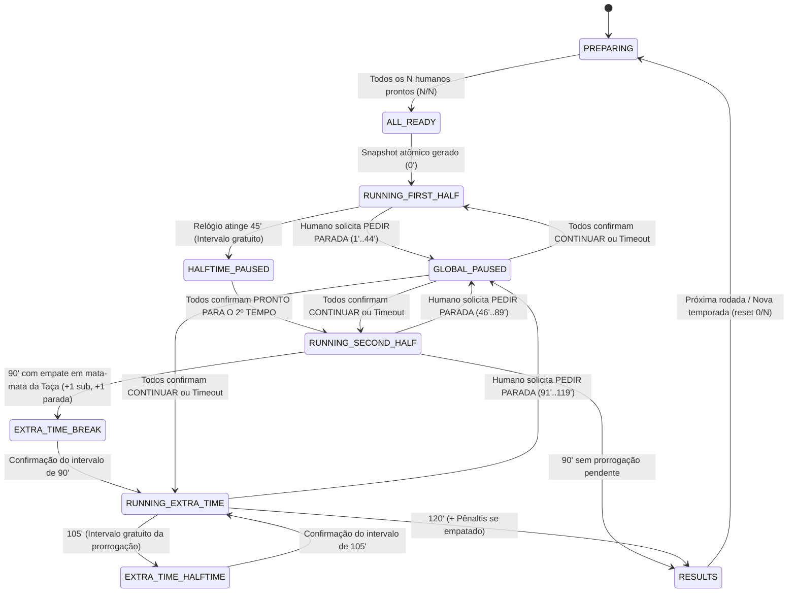

# Sincronismo Multiplayer, Contador `0/N` e Pausa Global (`MultiplayerRoundOrchestrator`)

A orquestração multiplayer em `src/Elifoot.Application/MultiplayerRoundOrchestrator.cs` implementa autoridade total no servidor, isolamento por `GameWorldId` e sincronismo estrito entre 1 e 8 treinadores humanos.

## 1. Máquina de Estados da Rodada (`RoundState`)

## 2. O Contador `TÁTICAS ENVIADAS: 0/N`

- O denominador $N$ é exatamente o número de **participantes humanos válidos na sala** (`1..8`), nunca o número de clubes controlados por IA.
- Treinadores humanos **desempregados** permanecem no denominador $N$ e possuem a ação `PRONTO PARA ACOMPANHAR` (`SubmitUnemployedReadyAsync`).
- Toda submissão recebe `IdempotencyKey` e é serializada por um `SemaphoreSlim` exclusivo da sala (`WorldLocks[worldId]`):
  - Enviar duas vezes pelo mesmo usuário não incrementa o contador.
  - Duas submissões simultâneas nos últimos lugares (`5/6` e `6/6`) são processadas em fila atômica e iniciam a rodada **uma única vez**.
  - Antes de atingir `N/N`, qualquer treinador pode clicar em `RETIRAR PRONTO` (`WithdrawReadyAsync`), decrementando o contador com segurança.

## 3. Regra da Parada Global (`PEDIR PARADA: TODOS param`)

1. Quando qualquer treinador humano clica em `PEDIR PARADA` durante a partida:
   - O servidor verifica se sua equipe ainda possui oportunidades de parada (`UsedPauseWindows < MaxPauseWindows`, onde o limite é `3` no tempo normal e `4` na prorrogação).
   - Se válido, o estado da sala muda imediatamente para `GLOBAL_PAUSED` e **todas as partidas da rodada congelam no mesmo minuto virtual** (incluindo jogos entre IAs).
   - Pedidos simultâneos no mesmo instante convergem para o **mesmo `PauseWindowId` compartilhado**, sem criar pausas sobrepostas.
2. **Consumo Individual de Oportunidade (`WindowQuota`)**:
   - O solicitante gasta `1` oportunidade própria (`1/3`).
   - Se **outro treinador humano** aproveitar a janela aberta para alterar tática ou fazer substituições (`SubmitInMatchAdjustmentAsync`), ele gasta `1` oportunidade própria (`1/3`) — apenas uma vez por `PauseWindowId`, mesmo que faça 2 ou 3 substituições e mude a tática na mesma janela.
   - Se o outro treinador **apenas observar e clicar em `CONTINUAR`**, ele **não gasta** nenhuma oportunidade (`0/3`).
3. **Intervalos Gratuitos**:
   - O intervalo de meio-tempo (`45'`), a pausa antes da prorrogação (`90'`) e o intervalo da prorrogação (`105'`) permitem alterações táticas e substituições **sem consumir oportunidade de parada**, descontando apenas do limite numérico de substituições (`5` no tempo normal, `6` na prorrogação).
