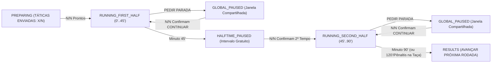

# EXPERIÊNCIA MULTIPLAYER SINCRONIZADA (2 A 8 TREINADORES) — TASK 011

- **Task**: `ELIFOOT_COMPLETE_GAMEPLAY_UI_011`
- **Projeto**: `D:\elifoot_98`
- **Capacidade Validada**: `2`, `4`, `6` e `8` treinadores humanos por sala

---

## 1. Fluxo de Sincronização de Rodada

O Elifoot 98 Multiplayer opera sob um modelo autoritativo por rodada (`roundVersion`), onde todos os treinadores humanos compartilham o mesmo ciclo de preparação, execução simultânea de partidas e fechamento de resultados:

---

## 2. Elementos de Interface Multiplayer

1. **Contador Sincronizado de Táticas (`ready-counter-label`)**:
   - Exibe em destaque `TÁTICAS ENVIADAS: X/N` no cabeçalho persistente e nos cartões de sala do lobby.
   - Abaixo do cabeçalho, pílulas individuais indicam o estado de cada participante humano:
     - `[OK] Apelido (Clube)` em verde claro quando pronto.
     - `[..] Apelido (Clube)` em cinza quando ainda está escalando ou negociando no mercado.
     - Sufixo `• DESCONECTADO` caso a conexão em tempo real do participante caia.

2. **Reversibilidade na Preparação (`RETIRAR PRONTO`)**:
   - Enquanto nem todos os `N` humanos enviaram tática (`X < N`), qualquer treinador que já tenha enviado pode clicar em `RETIRAR PRONTO` (`btn-retirar-pronto`), voltando ao estado editável (`X - 1 / N`).
   - Assim que o `N`-ésimo treinador envia a tática (ou marca `PRONTO PARA ACOMPANHAR` se estiver sem clube), `roundStarted == true` dispara a transição automática da tela para a Aba 2 (`2. JOGOS AO VIVO`).

3. **Janela de Pausa Global Compartilhada (`activePauseWindow`)**:
   - Qualquer treinador humano com cotas disponíveis (`PARADAS < 3` no tempo normal, `< 4` na prorrogação da Taça) pode acionar `PEDIR PARADA` (`btn-pedir-parada`).
   - Todas as partidas da rodada congelam no mesmo minuto (`GLOBAL_PAUSED`), exibindo o banner vermelho/dourado:
     - `PARTIDA PAUSADA POR <Treinador> (XX')`
     - `AJUSTES CONFIRMADOS: C/N | TEMPO: Ys`
   - Durante a janela, **todos** os treinadores humanos podem realizar substituições e alterações de formação em suas respectivas partidas através do painel interativo `in-match-substitution-panel`.
   - Ao clicar em `CONTINUAR` (`btn-confirmar-continuar`), o estado visual muda para `PARTIDA PAUSADA • AGUARDANDO RETOMADA` até que todos os `N` treinadores confirmem (ou o cronômetro da janela expire).

---

## 3. Validação em Salas de 2, 4, 6 e 8 Treinadores Humanos

Validado contra a API local real (`scripts/run_playtest_011.ps1` -> `docs/evidence/gameplay_011/live-playtest-bundle-011.json`):

| Tamanho da Sala (`maxHumans`) | Contador Inicial | Disparo da Partida | Pausa Global (`30'`) | Substituição na Janela | Retomada Sincronizada | Avanço p/ Rodada 2 |
|---|---|---|---|---|---|---|
| **2 Treinadores** | `TÁTICAS ENVIADAS: 0/2` | No envio `2/2` | `GLOBAL_PAUSED` por `Técnico MP 1` | Aplicada (`1/5` subs) | Na confirmação `2/2` | `Rodada 2 (PREPARING)` |
| **4 Treinadores** | `TÁTICAS ENVIADAS: 0/4` | No envio `4/4` | `GLOBAL_PAUSED` por `Técnico MP 1` | Aplicada (`1/5` subs) | Na confirmação `4/4` | `Rodada 2 (PREPARING)` |
| **6 Treinadores** | `TÁTICAS ENVIADAS: 0/6` | No envio `6/6` | `GLOBAL_PAUSED` por `Técnico MP 1` | Aplicada (`1/5` subs) | Na confirmação `6/6` | `Rodada 2 (PREPARING)` |
| **8 Treinadores** | `TÁTICAS ENVIADAS: 0/8` | No envio `8/8` | `GLOBAL_PAUSED` por `Técnico MP 1` | Aplicada (`1/5` subs) | Na confirmação `8/8` | `Rodada 2 (PREPARING)` |
