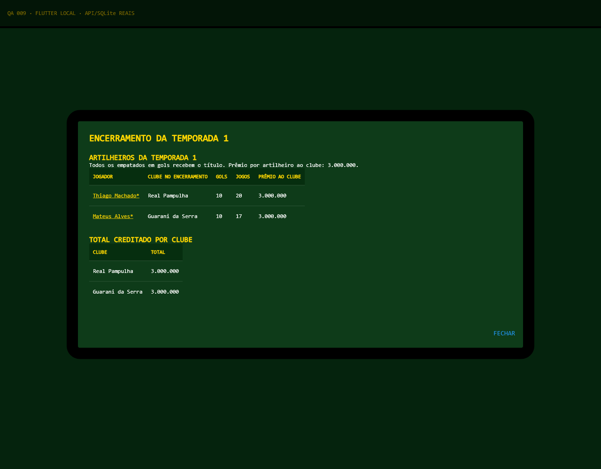
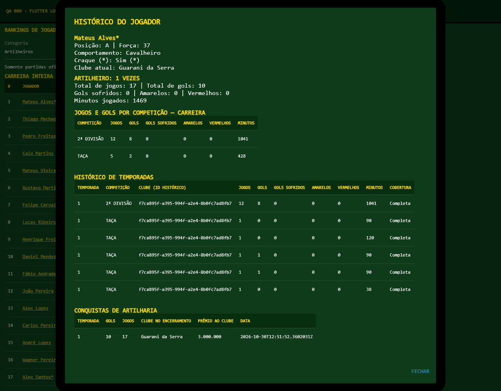

# Validação local complementar 009

30/10/2026, America/Sao_Paulo. **STATUS geral: PARTIAL. WEB_BROWSER: BLOCKED. FLUTTER_REAL_DATA_RENDER: PASS.**

A implementação existente foi preservada. Nenhum arquivo de produção foi alterado nesta retomada. As 237 regressões .NET já aprovadas continuam válidas para o mesmo código; os hashes foram conferidos. A suíte Flutter de 28 casos foi reexecutada e adicionaram-se dois testes locais separados, com renderização de dados reais, sem inserir estatísticas no banco.

## Acesso ao navegador e alternativas

O usuário informou que Work > Uso do navegador local está ativado. A nova chamada oficial `cua.createBrowserTab` continuou retornando `Local browser use is disabled in Work settings`. O inventário oficial retornou zero navegadores disponíveis e o mesmo erro. Isso comprova o bloqueio efetivo da ferramenta, mas não comprova qual configuração interna o causou. Não se atribui a causa ao projeto Elifoot nem se afirma que o usuário deixou a opção desligada.

A documentação oficial distingue controles do navegador embutido, Browser Use externo e Computer Use nativo. Também distingue permissões de arquivos/comandos das de browser. Não há, nas fontes consultadas, diagnóstico conclusivo para esta divergência específica entre a opção ativada e a resposta da sessão. [ChatGPT Work local security](https://learn.chatgpt.com/docs/enterprise/chatgpt-work-local-security), [Configurações do app](https://learn.chatgpt.com/docs/app/settings).

Foram avaliadas estas alternativas:

| Alternativa | Resultado |
| --- | --- |
| Navegador oficial do app | BLOCKED; nenhuma aba criada. |
| Outro navegador pelo inventário autorizado | Nenhum navegador autorizado foi exposto. A existência de uma janela do Chrome como app nativo não foi usada para contornar a negativa de Browser Use. |
| Flutter desktop Windows | O projeto não contém plataforma `windows/`. Não se acrescentou plataforma nem instalou toolchain para mudar o escopo do produto. |
| HTTP real dentro de widget test | Tentativa limitada e preservada. O ambiente de relógio/rede do teste não concluiu a operação e houve timeout. Não é falha comprovada da aplicação. |
| Renderizador Flutter com respostas reais capturadas | PASS: 59 respostas HTTP capturadas da API local; corpos reproduzidos sem editar estatísticas; widgets de produção renderizados pelo engine Flutter. |
| Browser por Selenium/CDP/automação de janela | Não usado, para respeitar o bloqueio de navegador comunicado pela ferramenta. |
| Publicar/túnel para browser remoto | Não usado; o projeto permaneceu privado e não houve publicação. |

## Método da evidência complementar

1. `scripts/verify-player-rankings-009.mjs` voltou a confrontar as 18 combinações de categoria/competição com o snapshot SQLite: todas coincidiram.
2. `scripts/capture-player-ui-data-009.mjs` capturou respostas de carreira, temporada atual, temporada 1, dois perfis e premiações: **59 corpos HTTP**, guardados integralmente com SHA256 em `audit-009/live-ui-response-snapshot.json`.
3. `client/elifoot_flutter/tool/qa/player_rankings_live_009_test.dart` montou os widgets reais `PlayerRankingsScreen`, perfil e diálogo de encerramento no engine de testes Flutter. Somente o transporte foi reproduzido em memória; não se geraram gols, títulos ou valores artificiais.
4. Fonte Consolas local foi carregada como fonte de QA/monospace para obter texto legível no renderizador de testes. Isso não altera as fontes do produto. As imagens têm faixa identificando QA Flutter local.
5. Foram exercitados seis filtros de artilharia, goleiros e defensores gerais, toque no perfil de Mateus Alves*, diálogo de premiação e largura 390px com deslocamento horizontal confirmado pelo controlador de rolagem.

Esta evidência é **renderização real de widgets com dados reais**, usando transporte HTTP reproduzido. **Não é uma sessão de navegador, execução nativa Android ou prova do DOM/CanvasKit do Flutter Web.** O teste de cinco conquistas continua sendo um teste determinístico da suíte anterior; o banco real tem uma conquista por vencedor e não foi adulterado para criar cinco.

Os ícones/fontes do renderizador de testes podem diferir do navegador; por isso a conferência dessas imagens não certifica CanvasKit, DOM, teclado ou comportamento do browser. A tabela detalhada do perfil existente identifica o clube histórico por ID; os prêmios e o cabeçalho usam nomes legíveis. Isso foi preservado nesta retomada, que não alterou o código de produção.

## Resultados conferidos

| Item | Resultado |
| --- | --- |
| Artilheiros geral | Mateus Alves*: 17 jogos, 10 gols, média exibida 0,588. Thiago Machado*: 20 jogos, 10 gols, média 0,500. |
| Recortes | 1ª, 2ª, 3ª, 4ª divisão e Taça renderizados e valores do primeiro colocado comparados às respostas capturadas. |
| Goleiros geral | Pedro Silva, 20 jogos, 23 sofridos, média 1,150; inelegíveis separados. |
| Defensores geral | Quantidade de jogos e cartões renderizados e comparados ao JSON; mínimo 20 mantido. |
| Perfil | Mateus Alves*, 17 jogos, 10 gols, 1.469 minutos; 8 gols da 2ª e 2 da Taça; uma conquista. |
| Premiação | Os dois vencedores com 10 gols, 20/17 jogos e 3.000.000 por clube, sem desempate pelo número de jogos. |
| Layout 390px | Sem exceção de layout; rolagem horizontal moveu a tabela e expôs jogos/gols/média. |

## Imagens do renderizador Flutter

As imagens abaixo foram inspecionadas. São renders do teste local, não capturas de navegador.





[Geral](audit-009/live-flutter-render/scorers-general.png), [1ª](audit-009/live-flutter-render/scorers-division1.png), [2ª](audit-009/live-flutter-render/scorers-division2.png), [3ª](audit-009/live-flutter-render/scorers-division3.png), [4ª](audit-009/live-flutter-render/scorers-division4.png), [Taça](audit-009/live-flutter-render/scorers-cup.png), [goleiros](audit-009/live-flutter-render/goalkeepers-general.png), [defensores](audit-009/live-flutter-render/defenders-general.png), [390px à esquerda](audit-009/live-flutter-render/width-390-left.png), [390px após rolagem](audit-009/live-flutter-render/width-390-scrolled.png).

## Reprodução e limites

Com a API privada 5089 e o banco do `dev-session.json` em execução:

```powershell
Set-Location D:\elifoot_98
node scripts/verify-player-rankings-009.mjs
node scripts/capture-player-ui-data-009.mjs
Set-Location client\elifoot_flutter
flutter test tool/qa/player_rankings_live_009_test.dart --reporter expanded
```

Esse runner fica em `tool/qa`, fora da suíte hermética padrão em `test/`, pois depende da captura do ambiente privado e da fonte local. Logs: [renderização 2 casos](audit-009/live-flutter-render-tests.log), [analyze](audit-009/resumed-flutter-analyze.log), [regressão Flutter](audit-009/resumed-flutter-tests.log). [Valores e método](audit-009/live-flutter-render/validation.json).

A etapa obrigatória de navegador real continua pendente. A tarefa permanece **PARTIAL**; não se promoveu o status a PASS por causa da alternativa. O banco e a aplicação privada continuam preservados em `http://127.0.0.1:8089/` e API `http://127.0.0.1:5089/`.
