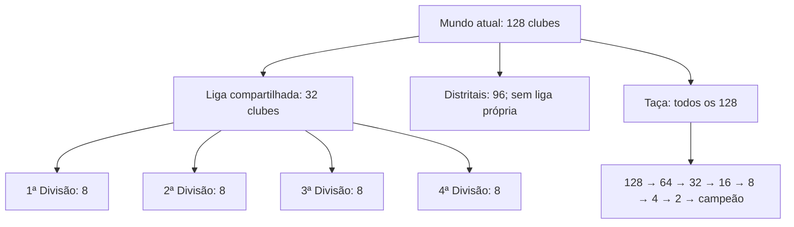

# Estrutura atual — clubes, países e divisões

Auditoria somente leitura em 2026-11-11T19:16:21-03:00. Mundo **testeno dois jogadores**, ID `b17ae7da-5be3-483a-9bb7-fb0e8a1a38c8`, temporada 1, rodada 4.

**128 clubes por mundo, não por país.** Liga compartilhada: 4 divisões × 8 = 32 clubes, mais 96 distritais que participam da Taça. País não cria uma liga independente.

| País | 1ª | 2ª | 3ª | 4ª | Distrital | Total | Humanos | IA |
| --- | --- | --- | --- | --- | --- | --- | --- | --- |
| Portugal | 8 | 8 | 8 | 8 | 34 | 66 | 2 | 64 |
| Espanha | 0 | 0 | 0 | 0 | 62 | 62 | 0 | 62 |

**Catálogo disponível:** Portugal (PT) e Espanha (ES), 128 variantes masculinas de QA, anos 1985 e 2025. A pasta canônica de dados reais está vazia. Brasil aparece em oito outros mundos de teste da fábrica; não é opção carregada no catálogo local ativo.

Controle: **2 humanos, 126 IA, 0 sem técnico**. IA não significa clube inexistente ou uma vaga humana garantida. A sala foi configurada para dois humanos e está ocupada pelos dois. Humanos não controlam distritais.

## Portugal

### 1ª Divisão — 8 clubes

| Clube | ClubId | Status |
| --- | --- | --- |
| Clube QA 0 (1985) | 4d502d81-0068-1940-a598-ff0ad1f4a5d7 | IA |
| Clube QA 0 (2025) | ada5a7bc-01d2-8c47-8743-28bc205197c0 | IA |
| Clube QA 1 (1985) | 56a70f20-0caf-0c40-ad21-9728bf7803a4 | IA |
| Clube QA 2 (1985) | ec48a3f3-50b5-dc4e-9c84-c600f03a4514 | IA |
| Clube QA 3 (1985) | 5bdd1673-fb55-cb4c-afab-358b8eee0875 | IA |
| Clube QA 4 (1985) | d4c6adca-5685-e441-8b71-01d53f7e710e | IA |
| Clube QA 5 (1985) | 5b4f4b74-bf5c-144c-ab5b-10a7fc48126f | IA |
| Clube QA 6 (1985) | c456cd04-3245-034c-ac6d-096b8bf1e94d | IA |

### 2ª Divisão — 8 clubes

| Clube | ClubId | Status |
| --- | --- | --- |
| Clube QA 7 (1985) | a0b184da-a4ce-614f-b76e-37b489918a3c | IA |
| Clube QA 8 (1985) | 88390903-ec83-8748-a8e5-c8fc48eb7925 | IA |
| Clube QA 9 (1985) | bf8e23de-3a8e-3647-90e2-6ed74536364a | IA |
| Clube QA 10 (1985) | 3fa93ded-68c1-5946-ad90-59a450a5df36 | IA |
| Clube QA 11 (1985) | 01b233e9-aacf-0943-8959-7588da1d9abd | IA |
| Clube QA 12 (1985) | 74f3a896-cdff-154b-b991-df7b5641e371 | IA |
| Clube QA 13 (1985) | 90b4b31e-cab7-5546-863c-9c0e9b58cdd3 | IA |
| Clube QA 14 (1985) | a2585565-8698-f240-8876-9d89bf8919c3 | IA |

### 3ª Divisão — 8 clubes

| Clube | ClubId | Status |
| --- | --- | --- |
| Clube QA 15 (1985) | 45a36ed6-5e2c-7140-89d7-4c241b743b4b | IA |
| Clube QA 16 (1985) | 8fe81b82-272f-f04d-9d8b-ff7ed55ad17d | IA |
| Clube QA 17 (1985) | 8584d9d1-24e1-bb44-9f66-beb411d1674f | IA |
| Clube QA 18 (1985) | 4dd18230-9e9f-f241-9d33-2f9518525cab | IA |
| Clube QA 19 (1985) | f2042ee2-7249-4a45-aa60-dea1a6a25c82 | IA |
| Clube QA 20 (1985) | 673c06f6-4733-2a41-9c1a-9542b60ec1af | IA |
| Clube QA 21 (1985) | 09fbfb1a-d941-464f-b397-d613496af920 | IA |
| Clube QA 22 (1985) | 7caf8132-1f4d-744d-8145-0b0016cb6e86 | IA |

### 4ª Divisão — 8 clubes

| Clube | ClubId | Status |
| --- | --- | --- |
| Clube QA 23 (1985) | d7816774-4281-c346-a83e-8850b564f97d | IA |
| Clube QA 24 (1985) | 57da6814-faec-264b-89de-b36467d77ea7 | IA |
| Clube QA 25 (1985) | f66578aa-6f7b-2144-8bfc-1f90bf0b9cb6 | HUMANO |
| Clube QA 26 (1985) | 42bfe749-8efc-624a-860a-d5cee72e9402 | IA |
| Clube QA 27 (1985) | 9cd0288a-fb8f-3c4a-a8ac-80fd215d4d42 | IA |
| Clube QA 28 (1985) | c511b6f0-0d64-8040-90fc-1e95bd879ecf | HUMANO |
| Clube QA 29 (1985) | 53a03d01-58f0-fd40-87dc-abcdb9dee385 | IA |
| Clube QA 30 (1985) | e8c39b4a-310b-e94c-ab09-c5a1675b5d23 | IA |

### Distrital — 34 clubes

| Clube | ClubId | Status |
| --- | --- | --- |
| Clube QA 31 (1985) | 69bd946b-071e-cf4b-9fa0-18a84f3adcf7 | IA |
| Clube QA 32 (1985) | abfa7c61-9dec-5147-8ada-b9eddc1f609a | IA |
| Clube QA 33 (1985) | c00269e5-6484-6d44-aab7-246f25d168b1 | IA |
| Clube QA 34 (1985) | 31d65a42-0b0e-ab4e-b13d-26602ccbc31a | IA |
| Clube QA 35 (1985) | c6c3f7a5-c033-d345-9830-9b5be813338d | IA |
| Clube QA 36 (1985) | 0fa508ac-8502-e44e-9bdb-81c73bf31071 | IA |
| Clube QA 37 (1985) | 55f3c758-8f33-3842-96af-b256585ccd0c | IA |
| Clube QA 38 (1985) | 0e5bddb3-6d25-0e40-8472-8ff1f989614e | IA |
| Clube QA 39 (1985) | b1aefaec-e6a5-a344-a6f1-076c47f2c42f | IA |
| Clube QA 40 (1985) | e183de64-f9d1-0a44-8fb9-cfab5276829c | IA |
| Clube QA 41 (1985) | a81796bd-3e5f-0d47-b218-c6779b867481 | IA |
| Clube QA 42 (1985) | 38e39e88-1551-7b44-b996-b0bb50de6624 | IA |
| Clube QA 43 (1985) | cba8523e-cce2-4248-9bd6-a4f39b9b5ce3 | IA |
| Clube QA 44 (1985) | 7a0115fe-e575-8147-8231-8f05218996e3 | IA |
| Clube QA 45 (1985) | 8924f60a-3cc6-134f-a0a7-1ecd82dfe3b0 | IA |
| Clube QA 46 (1985) | c0ceb244-66bb-7c44-9fb7-2e86a057363b | IA |
| Clube QA 47 (1985) | c6c0725a-40a5-994d-b16b-5bed87655dd9 | IA |
| Clube QA 48 (1985) | aa764e7b-9d7f-5d47-811f-957dbbc68b28 | IA |
| Clube QA 49 (1985) | 98a73f25-b521-804d-ba70-c38c15a5f088 | IA |
| Clube QA 50 (1985) | 470316e0-a0b5-c140-a507-ea802f081b51 | IA |
| Clube QA 51 (1985) | b6214373-01bf-4d45-9cd0-c6df15ca043c | IA |
| Clube QA 52 (1985) | 87ee0365-85e9-ac4a-8789-c2edae5f7569 | IA |
| Clube QA 53 (1985) | c0cbbbdb-cd18-2148-9641-c134a1d11a34 | IA |
| Clube QA 54 (1985) | 89be8dc3-1db4-5545-94d3-9b10e6332a2c | IA |
| Clube QA 55 (1985) | bf70aa19-4a14-e945-9b20-910844ad6569 | IA |
| Clube QA 56 (1985) | 0784d0a3-0f4c-5a4a-a8f2-fc90e7930a4a | IA |
| Clube QA 57 (1985) | 97e40965-1381-b941-9ab7-c6422bd83808 | IA |
| Clube QA 58 (1985) | 31da8c2a-28d3-224e-902b-4529ec871683 | IA |
| Clube QA 59 (1985) | 3b812570-77e0-764f-b1b7-e19dc9bd18d9 | IA |
| Clube QA 60 (1985) | e8dd54a0-109a-684a-bc35-3f400d877912 | IA |
| Clube QA 61 (1985) | 262845d6-e2d3-db4a-bf68-1a620c76ee94 | IA |
| Clube QA 62 (1985) | a7987ca8-fa03-8842-8867-49370c7000df | IA |
| Clube QA 63 (1985) | 8069378a-3c79-4844-a524-a9973080a5c4 | IA |
| Clube QA 64 (1985) | c370164b-3830-a848-8c19-1b1fbbb8846f | IA |

## Espanha

### 1ª Divisão — 0 clubes

Nenhum clube deste país nesta divisão.

### 2ª Divisão — 0 clubes

Nenhum clube deste país nesta divisão.

### 3ª Divisão — 0 clubes

Nenhum clube deste país nesta divisão.

### 4ª Divisão — 0 clubes

Nenhum clube deste país nesta divisão.

### Distrital — 62 clubes

| Clube | ClubId | Status |
| --- | --- | --- |
| Clube QA 65 (2025) | d20a1cdc-b836-1649-8f65-a8979017e29d | IA |
| Clube QA 66 (2025) | 3a049f1b-7411-6743-b6be-81de182664ab | IA |
| Clube QA 67 (2025) | a4d5de83-08a9-9843-ad1f-1fcb2cc86694 | IA |
| Clube QA 68 (2025) | 9d599032-135e-3b46-ab74-a5d90a77e4a8 | IA |
| Clube QA 69 (2025) | 19d3fa46-5695-df4f-a3c8-5ecbf51849ac | IA |
| Clube QA 70 (2025) | 457aa0f8-ae8b-8845-a1bd-90a8fad91621 | IA |
| Clube QA 71 (2025) | e926f201-c7d4-744f-bcea-2c1e10302d93 | IA |
| Clube QA 72 (2025) | 9ac42978-eeed-1145-9602-c934ee8bc231 | IA |
| Clube QA 73 (2025) | 7faba1b4-d187-7141-b253-8740d07678cf | IA |
| Clube QA 74 (2025) | dadbb572-186a-3d46-9024-a8d46f47f775 | IA |
| Clube QA 75 (2025) | 860ede16-7ae1-df49-82d0-e3b39339582c | IA |
| Clube QA 76 (2025) | 2321a481-d9bb-9f46-9d22-628f69a1b9e5 | IA |
| Clube QA 77 (2025) | 9d19b063-278d-224b-aa26-5eaead5f1019 | IA |
| Clube QA 78 (2025) | 77664085-6051-e84b-acc6-a187690837ac | IA |
| Clube QA 79 (2025) | d1f5a1a9-54be-8e4f-a06c-a67b6048474d | IA |
| Clube QA 80 (2025) | bb52b6ee-dfbc-6d45-ba49-0d64bd242be9 | IA |
| Clube QA 81 (2025) | c6b63f3c-afee-a442-886d-2b7ee6c57c03 | IA |
| Clube QA 82 (2025) | 84a76c42-8445-d548-81a2-2bbfbb89e748 | IA |
| Clube QA 83 (2025) | a7fbf998-91a5-3f4c-8ee9-813a4b1fab1d | IA |
| Clube QA 84 (2025) | 2ec73a97-03c5-0b43-93d1-56fdcf0e97f5 | IA |
| Clube QA 85 (2025) | 166ae730-8451-e94b-a344-685bfd94df59 | IA |
| Clube QA 86 (2025) | 1f5e2fab-5917-ca44-baad-95d7d2196de5 | IA |
| Clube QA 87 (2025) | 2e8e682a-e35e-4544-97da-bb41ce48600c | IA |
| Clube QA 88 (2025) | 66b81f44-6262-724e-ac16-5161074b2c0f | IA |
| Clube QA 89 (2025) | 8afef28a-3671-6c4a-a5ec-1c44bff0babc | IA |
| Clube QA 90 (2025) | 133ee527-8726-9748-bfcf-5b8e04fc6e1b | IA |
| Clube QA 91 (2025) | cdb4afe6-7dfd-6646-b687-8f3c3522427e | IA |
| Clube QA 92 (2025) | 73f42010-06d4-2445-a40a-476be90a50dc | IA |
| Clube QA 93 (2025) | 90e8a781-d73a-5641-ace7-38e803dc40a3 | IA |
| Clube QA 94 (2025) | a0c9116d-9368-c54f-a423-b02e5790f6fc | IA |
| Clube QA 95 (2025) | 89f61893-880b-e944-a537-8625fbc33d7b | IA |
| Clube QA 96 (2025) | 1d085914-5862-4c45-b39b-a3d7990dd48e | IA |
| Clube QA 97 (2025) | 78edd2e8-1ed0-3e47-aad9-8a0681abeb3b | IA |
| Clube QA 98 (2025) | c997d79e-eafc-bf45-9cd3-a6f4528dee85 | IA |
| Clube QA 99 (2025) | 86837388-9a58-7445-bd6e-1ed8e895942b | IA |
| Clube QA 100 (2025) | 03d90c15-3497-ff47-a083-f023b2d84683 | IA |
| Clube QA 101 (2025) | 2808ba12-6e29-5544-b126-80b3f36e4e99 | IA |
| Clube QA 102 (2025) | 19f1c5c1-8f60-1b40-a741-f7270ea4f8f8 | IA |
| Clube QA 103 (2025) | a831871a-69b3-784d-9170-682dfae1e19e | IA |
| Clube QA 104 (2025) | d8ac1b0a-e516-c941-b079-50900bb65a70 | IA |
| Clube QA 105 (2025) | 743f2b47-edb0-b044-b413-c42ced9af4e3 | IA |
| Clube QA 106 (2025) | e78f2ccf-d19b-1e48-a095-7ad6cb51e6b6 | IA |
| Clube QA 107 (2025) | 0de64a48-1b93-ce4e-884a-11c7a43bb217 | IA |
| Clube QA 108 (2025) | 1edb124f-e29e-2a44-bc58-9214f7713dfb | IA |
| Clube QA 109 (2025) | b577b726-af8e-424e-a530-d2477f5c5745 | IA |
| Clube QA 110 (2025) | ca4797f4-5eb2-a64f-984e-653da05f71fc | IA |
| Clube QA 111 (2025) | 525ee8eb-0d50-6342-9fff-23b830d90274 | IA |
| Clube QA 112 (2025) | 01073572-f930-3e4a-9130-df801a52617a | IA |
| Clube QA 113 (2025) | 1dbd3687-65c9-ac44-be36-84462c4a1f07 | IA |
| Clube QA 114 (2025) | c67866bd-130d-124e-b69a-943d6cda0bd0 | IA |
| Clube QA 115 (2025) | 298bc03e-449d-2b4c-93a9-56a3ef71fc80 | IA |
| Clube QA 116 (2025) | df71547b-140b-034b-bf26-11d91c142dad | IA |
| Clube QA 117 (2025) | 80dff6f2-e47f-104c-84e6-0fdaf2e811f3 | IA |
| Clube QA 118 (2025) | 71ff9541-a224-4249-957a-765023f98c64 | IA |
| Clube QA 119 (2025) | 3b01b882-acb4-1543-a73a-059b92acc3ce | IA |
| Clube QA 120 (2025) | 38892068-7795-0c4a-ab41-5952a2198fd9 | IA |
| Clube QA 121 (2025) | 1f540546-4851-db42-be1b-2ce6ae1ba603 | IA |
| Clube QA 122 (2025) | 557bed43-f7e2-984d-9e13-c7e2248d502f | IA |
| Clube QA 123 (2025) | f9639918-d651-8c46-ae7a-3cf97e2ddb3f | IA |
| Clube QA 124 (2025) | d17d3a8a-26fc-8245-9711-9440542afa27 | IA |
| Clube QA 125 (2025) | 857510ba-ce2e-4944-90d0-9bfcf1e60025 | IA |
| Clube QA 126 (2025) | 1bd9f1a4-6bef-074c-87c1-25e77c3fdff6 | IA |

## Como montar sem mexer no save atual

Cadastre versões de clubes e elencos na pasta canônica, usando o modelo JSON existente e fontes verificáveis. Revise depois uma montagem antes de criar um novo mundo; preserve 8 clubes em cada divisão e 96 distritais. A mistura atual resulta do ranking global dos arquivos de QA; não garante equilíbrio entre países. O editor de montagem permite revisar nomes, país, cores, estádio, jogadores e alocação antes da confirmação. Nenhuma dessas operações foi executada nesta auditoria.

O CSV tem 128 linhas de clubes exclusivamente deste mundo, separador `;` e UTF-8 com BOM. `Capacidade` é a construída; `SaldoInicial` vem de `InitialBalance`, não do caixa corrente; `Jogadores` é a quantidade atual vinculada. `Sigla=N/D` porque não há campo separado: o editor chama `ShortName` de “Sigla”.
